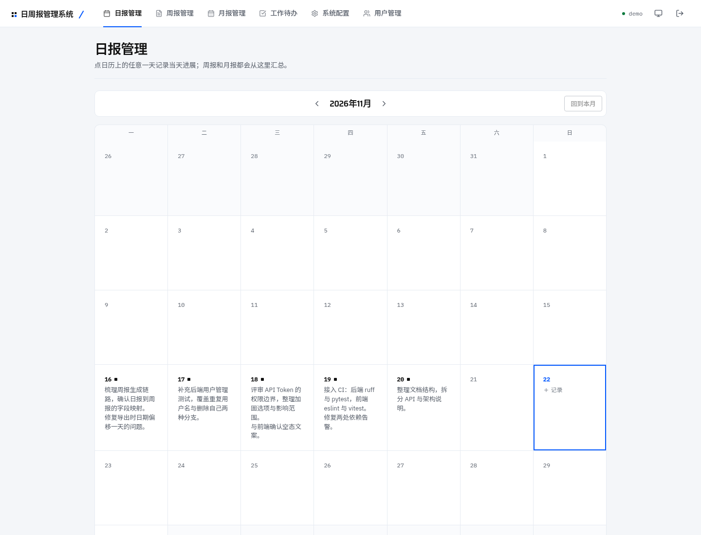
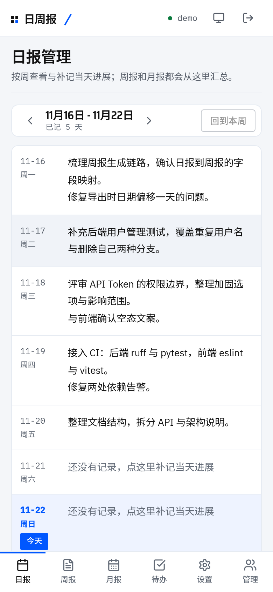
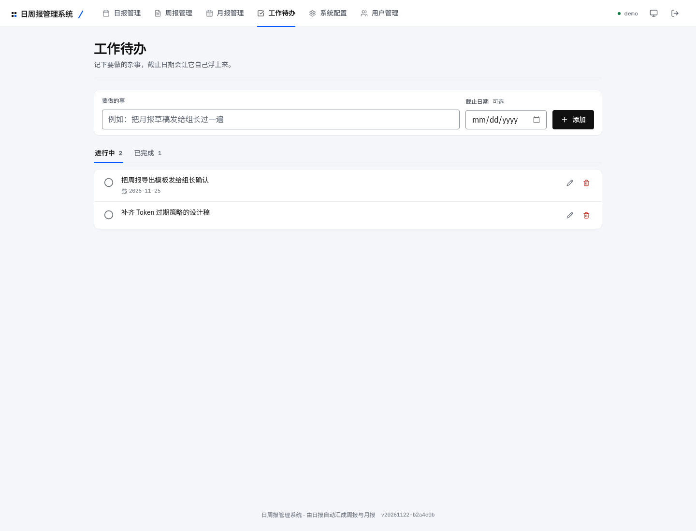
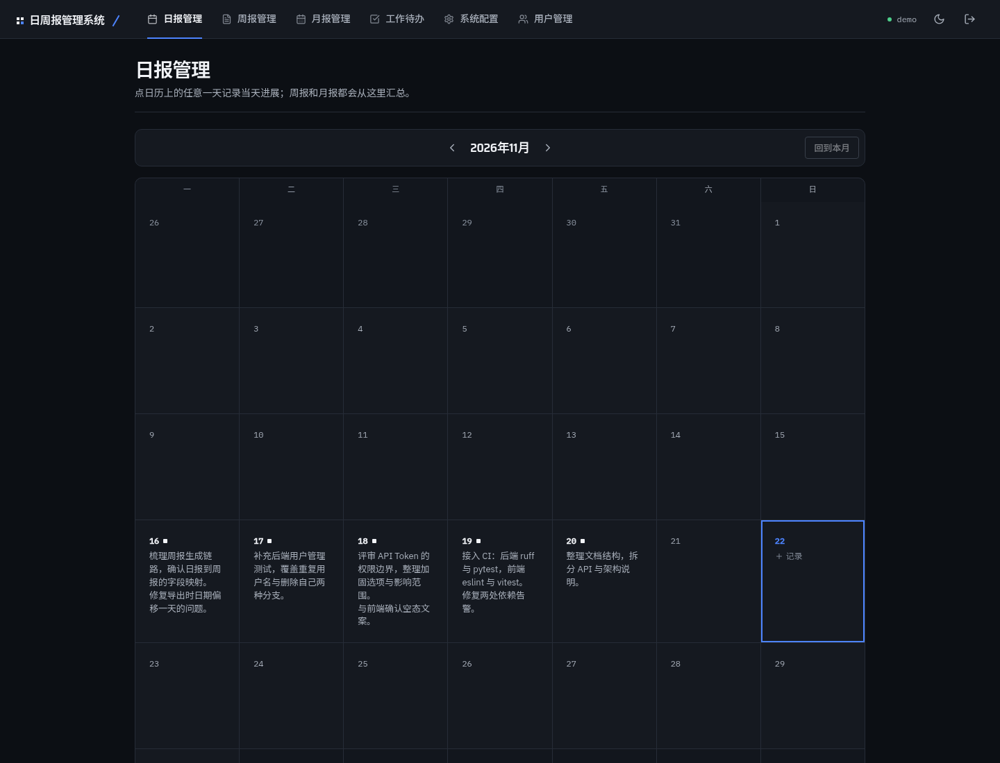

# 周报/月报自动生成系统

[](https://github.com/hmilyld/weekly-report/actions/workflows/ci.yml)
[](LICENSE)
[](https://github.com/hmilyld/weekly-report/pkgs/container/weekly-report)

按天记录进展，由大模型汇总成周报和月报。前端 React + Vite，后端 Python FastAPI，SQLite 存储，支持多用户与管理员/普通用户两种角色。

界面为中文，可安装为 PWA（桌面 / 手机），支持跟随系统、亮色、暗色三种主题。

## 目录

- [功能](#功能)
- [界面](#界面)
- [快速开始（Docker）](#快速开始docker)
- [本地开发](#本地开发)
- [发布与部署](#发布与部署)
- [环境变量](#环境变量)
- [安全与备份](#安全与备份)
- [API](#api)
- [技术栈](#技术栈)
- [文档](#文档)
- [许可证](#许可证)

## 功能

- **日报** — 桌面端月历、手机端周列表，点格子记录当天进展，支持增删改
- **周报 / 月报** — 调用大模型把日报汇总成周报或月报，生成后可编辑、复制、重新生成
- **工作待办** — 记录待办与截止日期，逾期和临期自动标记，已完成的分页查看
- **多用户** — 管理员创建/删除用户、切换角色；每个用户的数据互相隔离，列表显示最近登录时间
- **系统配置** — 管理员在线修改大模型地址、模型名称、API Key，支持连接测试
- **API Token** — 用 Token 从脚本或外部服务写入日报、读取周报与待办，无需登录
- **安全** — JWT 登录保护；日报/周报/月报/待办内容信封加密存储（重启后无需重新登录）；改密不影响数据；改密后旧 JWT 立即失效（API Token 需显式吊销）

### 角色权限

| 功能 | 管理员 (admin) | 普通用户 (user) |
|------|:-:|:-:|
| 日报 / 周报 / 月报 / 待办 | ✓ | ✓ |
| 修改自己的密码 | ✓ | ✓ |
| 管理自己的 API Token | ✓ | ✓ |
| 大模型配置 | ✓ | ✗ |
| 用户管理（创建 / 删除 / 改角色） | ✓ | ✗ |

---

## 界面

以下截图使用示例数据（账号 `demo`）。

| 日报（桌面） | 日报（手机） |
|---|---|
|  |  |

| 工作待办 | 暗色模式 |
|---|---|
|  |  |

---

## 快速开始（Docker）

```bash
# 1. 生成 JWT 密钥与加密主密钥，写入 .env
echo "JWT_SECRET_KEY=$(python3 -c 'import secrets; print(secrets.token_urlsafe(64))')" > .env
echo "ENCRYPTION_MASTER_KEY=$(python3 -c 'import base64, secrets; print(base64.b64encode(secrets.token_bytes(32)).decode())')" >> .env

# 2. 启动（默认使用 Docker Hub 镜像）
docker compose up -d

# 3. 打开 http://localhost:18001
```

- 数据库落在 `./data/weekly_report.db`，升级镜像不会丢失。
- **备份必须同时包含数据库和 `ENCRYPTION_MASTER_KEY`**，丢失主密钥 = 内容永久不可读（见「安全与备份」）。
- 想用 GitHub 镜像：`IMAGE=ghcr.io/hmilyld/weekly-report:latest docker compose up -d`
- 本地改代码后重建：`docker compose up -d --build`

### 镜像来源

| 来源 | 地址 | 说明 |
|---|---|---|
| Docker Hub | `hmilyld/weekly-report` | 手动执行 `./scripts/docker-publish.sh [tag]` 发布 |
| GitHub Container Registry | `ghcr.io/hmilyld/weekly-report` | 推送 `v*` 标签自动发布 |

GitHub 镜像的标签规则：`1.2.0`（精确版本）、`1.2`、`1`、`latest`。预发布（如 `v1.2.0-rc1`）只发精确版本，不移动浮动标签与 `latest`。

发布方式见下方「发布与部署」。

### 手动构建镜像

```bash
docker build -t weekly-report:latest .

docker run -d \
  --name weekly-report \
  -p 18001:18001 \
  -v $(pwd)/data:/app/data \
  -e JWT_SECRET_KEY=your-secret-key-here \
  -e ENCRYPTION_MASTER_KEY=your-base64-32-byte-key-here \
  weekly-report:latest
```

---

## 本地开发

### 一键脚本（推荐）

```bash
bash scripts/dev.sh start     # 同时启动前后端
bash scripts/dev.sh status    # 查看状态
bash scripts/dev.sh logs      # 查看日志
bash scripts/dev.sh restart   # 重启
bash scripts/dev.sh stop      # 停止
```

首次运行会安装依赖。日志与 PID 文件在 `.dev/`（已忽略，不会提交）。

### 后端

```bash
cd backend
uv venv                                                    # 创建虚拟环境
uv pip install -r requirements.txt -r dev-requirements.txt  # 运行依赖 + 开发工具
uv run uvicorn main:app --reload --port 18001
```

### 前端

```bash
cd frontend
pnpm install
pnpm dev        # http://localhost:5173，/api 代理到 :18001
pnpm test       # 单元测试（vitest）
pnpm build      # 产物在 frontend/dist，后端会直接托管
pnpm generate:icons   # 重新生成应用图标（SVG；装了 ffmpeg 时同时输出 PNG）
```

### 质量检查

```bash
cd backend && uv run ruff check . && uv run ruff format --check . && uv run pytest
cd frontend && pnpm lint && pnpm format:check && pnpm test && pnpm build
```

CI 在每次 PR 上跑同一组命令（Python 3.11 / 3.12、Node 24）。架构、加密链路与必须保持的不变量见
[`docs/architecture.md`](docs/architecture.md)。

### 首次使用

首次访问会跳到初始化页面，创建第一个账号（自动成为管理员）。系统没有默认账号。

### 数据迁移

升级后启动后端会自动补齐新增字段与表（`app/schema_migrations.py`），无需手动执行脚本，也不需要 Alembic。旧版单用户数据库会保留原有数据，并把第一个用户提升为管理员。

> **信封加密迁移**：从旧版本（密钥由登录密码派生）升级时，每个账号在升级后的**首次登录**会一次性完成迁移——生成随机数据密钥（DEK）、把全部内容重新加密到 DEK 下、用主密钥包裹 DEK 存库。迁移在单个事务内完成，失败自动回滚、下次登录重试。迁移完成后，重启服务不再需要任何人登录即可读取内容；尚未登录过的账号在迁移前仍保持旧行为（重启后需登录一次）。
>
> **自动快照**：只要还存在未迁移的账号，升级后首次启动会自动生成一次性备份 `data/pre-envelope-<时间戳>.db`（SQLite 在线备份 API，权限 0600），作为不可逆升级的回退点。快照含旧密码可解的密文，请像数据库一样保护；确认升级无误后可删除。
>
> **迁移失败不锁死登录**：若某条历史记录无法用当前密码解密（例如旧版本改密中断留下的数据），登录仍然成功，但内容读取会标记失败、写入返回 409；服务端日志会指出无法解密的具体表与记录 id，修复数据后重新登录即可重试迁移。
>
> **启动时的明文清理**：历史版本曾在密文旁边残留明文。启动清理现在会先尝试解密该记录，**只有密文确实可读时才删除明文**；密钥缺失或密文损坏的记录会保留明文并在日志中列出表名与记录 id，避免把唯一可读副本清掉。

---

## 发布与部署

### 打标签自动发布到 GitHub 镜像

```bash
git tag -a v1.2.0 -m "v1.2.0"
git push origin v1.2.0
```

工作流 `.github/workflows/release-image.yml` 依次执行：校验标签、构建镜像、启动容器请求 `/api/v1/health` 完成冒烟测试，通过后推送到 `ghcr.io`。冒烟测试不通过时不会推送。

也可以在 Actions 页面手动运行 **Release image** 并填写标签（标签必须已存在于远端）。

### 手动发布到 Docker Hub

```bash
./scripts/docker-publish.sh          # 推送 latest
./scripts/docker-publish.sh v1.0.0   # 推送指定版本 + latest
```

脚本会本地构建、跑冒烟测试，再推送。

### 升级已部署的实例

```bash
# 0. 先备份！数据库 + ENCRYPTION_MASTER_KEY 一起备份
cp data/weekly_report.db data/weekly_report.db.bak-$(date +%F)

docker compose pull && docker compose up -d
```

数据库结构变更是增量的（只加字段/表），旧数据保留。

从本次版本起，启动校验更严格，升级前请确认：

| 变化 | 影响 | 处理 |
|---|---|---|
| 官方镜像默认 `ENV=production` | 缺少 `JWT_SECRET_KEY` 或 `ENCRYPTION_MASTER_KEY` 时容器**拒绝启动**（不再静默生成开发密钥） | 在 `.env` 里配好两个密钥 |
| `JWT_SECRET_KEY` 至少 32 字节，且不能是 `.env.example` 的占位值 | 过短的旧密钥会导致启动失败 | `python3 -c 'import secrets; print(secrets.token_urlsafe(64))'` 重新生成（已登录用户需重新登录一次） |
| 数据库启用 WAL | 在线备份必须带 `-wal`/`-shm`，否则可能丢最近事务 | 先 `docker compose stop` 再复制 `data/` |
| 未认证统一返回 `401`（原本部分管理接口返回 `403`） | 客户端若按 403 判断"权限不足"，需改为按 401 判断"凭据问题" | 见 [`docs/api.md`](docs/api.md) 的状态码约定 |

> **注意**：升级到信封加密版本并完成首次登录后，数据由新的 DEK 加密，旧版本镜像无法解密。升级前必须备份数据库；如需回退，只能恢复升级前的备份。

### Docker Swarm 与 Portainer

用 Swarm 编排时，`docker-compose.yml` 需要按栈规则调整。以下四项是硬性要求，其余保持默认即可：

- **副本数必须为 1**。SQLite 是单写者，两个任务同时运行会争锁，启动迁移也可能互相覆盖。滚动更新用 `update_config.order: stop-first`，先停旧任务再起新任务。
- **命名卷按节点各一份**。`deploy.placement.constraints` 要固定到持有数据的节点（`node.hostname == <节点名>`），否则任务漂移到其他节点会挂到空卷，看起来像数据丢失。
- **密钥通过栈环境变量或 Docker Secret 注入**，不要写进栈文件。使用 Secret 时在启动命令里导出为环境变量，且 `environment` 中不要再保留同名键。
- **副本减少前先确认数据位置**。用 `docker service ps` 查看任务所在节点，在对应节点上检查 `docker volume inspect weekly-report-data` 指向的目录。

最小可用栈文件：

```yaml
version: '3.8'

services:
  weekly-report:
    image: ghcr.io/hmilyld/weekly-report:1.2.0
    environment:
      - ENV=production
      - JWT_SECRET_KEY=${JWT_SECRET_KEY}
      - ENCRYPTION_MASTER_KEY=${ENCRYPTION_MASTER_KEY}
    volumes:
      - weekly-report-data:/app/data
    networks:
      - npm_proxy_net
    healthcheck:
      test: ["CMD", "python", "-c", "import urllib.request; urllib.request.urlopen('http://localhost:18001/api/v1/health')"]
      interval: 30s
      timeout: 5s
      retries: 3
      start_period: 15s
    deploy:
      replicas: 1
      placement:
        constraints:
          - node.hostname == 持有数据的节点名
      restart_policy:
        condition: any
      update_config:
        order: stop-first
      rollback_config:
        order: stop-first

volumes:
  weekly-report-data:

networks:
  npm_proxy_net:
    external: true
    name: npm_proxy_net
```

两个密钥在 Portainer 的 Stack → Environment variables 中填写，栈文件用 `${...}` 引用。`ENCRYPTION_MASTER_KEY` 本身就是 base64，如果用 Docker Secret 并开启 Portainer 的「Encode secret」，值会被再次编码导致启动校验失败，需关闭该选项。

部署后确认容器内实际生效的配置：

```bash
docker service ps <stack>_weekly-report --no-trunc
docker service inspect <stack>_weekly-report --format '{{json .Spec.TaskTemplate.ContainerSpec.Env}}'
docker service logs -f <stack>_weekly-report
```


---

## 环境变量

| 变量 | 必填 | 默认值 | 说明 |
|---|---|---|---|
| `JWT_SECRET_KEY` | 生产必填 | 开发环境随机生成 | JWT 签名密钥，**至少 32 字节**；`.env.example` 里的占位值会被拒绝。生产缺失或过短会启动失败 |
| `ENCRYPTION_MASTER_KEY` | 生产必填 | 开发环境自动生成并持久化到 `data/.encryption_key`（0600） | 信封加密主密钥，base64 编码、解码后必须 32 字节；生产缺失或格式错误会启动失败。**必须与数据库一起备份** |
| `DATABASE_URL` | 否 | `sqlite:///./data/weekly_report.db` | 数据库连接串（当前仅支持 SQLite） |
| `CORS_ORIGINS` | 否 | `*` | 允许的来源，逗号分隔。生产环境未设置时启动日志会告警（纯 Token/Bearer 调用不受影响） |
| `ENV` / `ENVIRONMENT` | 否 | `development`（官方镜像内为 `production`） | `production` 时：密钥必填、启用 HSTS。可以写在 `.env` 里 |
| `LOG_LEVEL` | 否 | `INFO` | 后端日志级别 |
| `APP_VERSION` | 否 | 构建参数 | 镜像构建时注入，显示在 `/openapi.json` 的 version |
| `IMAGE` | 否 | `hmilyld/weekly-report:latest` | `docker compose` 使用的镜像 |

大模型地址、模型名与 API Key 不通过环境变量配置，保存在数据库里，登录后在「系统配置」页面修改。API Key 同样用主密钥信封加密存储，重启后不会失效。读取与更新配置时 API Key 都以掩码返回（如 `sk-****7890`），传回掩码表示「保持不变」。

大模型地址会做 SSRF 校验：仅允许 `http`/`https`，主机解析后落在私有/链路本地/保留地址段的一律拒绝；**回环地址（`localhost`、`127.0.0.1`、`::1`）放行**，以便直连本机 Ollama / LM Studio。

---

## 安全与备份

### 加密如何工作（信封加密）

```
ENCRYPTION_MASTER_KEY ──HKDF──> KEK（仅进程内存）
KEK ──AES-256-GCM 包裹──> users.wrapped_dek（存库，绑定用户身份）
启动时解包 ──> 每用户一个随机 DEK ──AES-256-GCM──> 日报/周报/月报/待办内容
```

- 登录密码**只用于认证**，不再派生内容密钥：改密不重加密任何数据，密文保持不变。
- 服务重启后自动从数据库恢复所有密钥，**无需任何人重新登录**；API Token 写入在重启后照常加密。
- 没有可用密钥时写入会被拒绝（HTTP 409 `encryption_key_missing`），**绝不静默落明文**。
- 内容密文绑定所属表与用户（AAD），无法跨账号/跨表挪用。

### 它防住什么、不防什么

| 威胁 | 是否防住 |
|---|---|
| 数据库文件 / 备份泄露 | 可防：没有主密钥无法解密 |
| 长期离线备份 | 可防：前提是主密钥妥善保管 |
| 主机被入侵（含环境变量与进程内存） | 不可防：服务端生成周报必须读取明文，本系统不是零知识架构 |
| 登录密码泄露 | 不可防：密码用于认证，泄露后可登录读取 |

### 备份要求

数据库以 WAL 模式运行，写入会先落在 `data/weekly_report.db-wal`。**在线复制必须连 `-wal` / `-shm` 一起复制**，否则会丢失最近的事务；最稳妥的做法是先 `docker compose stop` 再复制整个 `data/` 目录。

**数据库和 `ENCRYPTION_MASTER_KEY` 必须一起备份。** 只备份数据库而丢失主密钥，内容将永久不可读；反之亦然。建议把 `.env`（或密钥管理系统中的主密钥）与 `data/weekly_report.db` 纳入同一备份策略。升级到信封加密版本时，服务还会自动生成一次性快照 `data/pre-envelope-*.db`（见「数据迁移」），可作为升级回退点。

开发环境未设置主密钥时会自动生成 `data/.encryption_key`（权限 0600），它同样需要随数据库一起备份。

### 主密钥轮换

主密钥泄露时：生成新主密钥，用旧主密钥解包每个用户的 DEK，再用新主密钥重新包裹并写回。内容密文无需改动，因为 DEK 未变。当前版本未提供自动化轮换命令，需通过脚本完成。

---

## API

所有接口前缀为 `/api/v1`。网页端使用 `Authorization: Bearer <JWT>`，脚本与移动端使用 `X-API-Token`。

端点清单、状态码约定、调用示例与健康检查见 [`docs/api.md`](docs/api.md)；机器可读定义见 `/openapi.json`。

---

## 技术栈

- **前端**：React 18、Vite 5、React Router 6、Axios、Lucide 图标、vite-plugin-pwa；手写 CSS（设计令牌见 `frontend/src/styles/tokens.css`）
- **后端**：Python 3.11、FastAPI、SQLAlchemy 2、python-jose、passlib/bcrypt、cryptography（AES-GCM 加密存储）、httpx
- **数据库**：SQLite（单文件，随 `./data` 挂载持久化）
- **部署**：多阶段 Docker 构建（Node 26 构建前端 + Python 3.15 运行），单容器同时提供 API 与前端

---

## 文档

| 文件 | 内容 |
|---|---|
| `PRODUCT.md` | 产品定位、用户、能力与约束（改需求前先读） |
| `DESIGN.md` | 设计系统：令牌、排版、组件、交互规则（改界面前先读） |
| `AGENTS.md` | 仓库结构与开发约定、提交规范、发布流程（给人和 AI 协作用） |
| `CONTRIBUTING.md` | 本地开发、提交规范与 PR 检查项（外部贡献者入口） |
| `SECURITY.md` | 漏洞报告通道与支持范围 |
| `CHANGELOG.md` | 面向用户的变更记录 |
| `docs/android-api.md` | Android / Token 客户端对接：认证、端点、日报/周报语义、错误码 |
| `docs/architecture.md` | 运行形态、模块边界、请求与加密链路、必须保持的不变量 |
| `docs/api.md` | HTTP 端点、认证方式、状态码与调用示例 |

---

## 许可证

本项目采用 [MIT 许可证](LICENSE)。

任何人均可自由使用、修改与分发本软件（包括商业用途），条件是在副本或主要部分中保留版权声明与许可证文本。软件按「现状」提供，不附带任何明示或暗示的担保。
